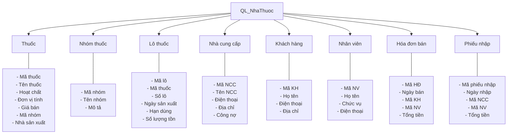
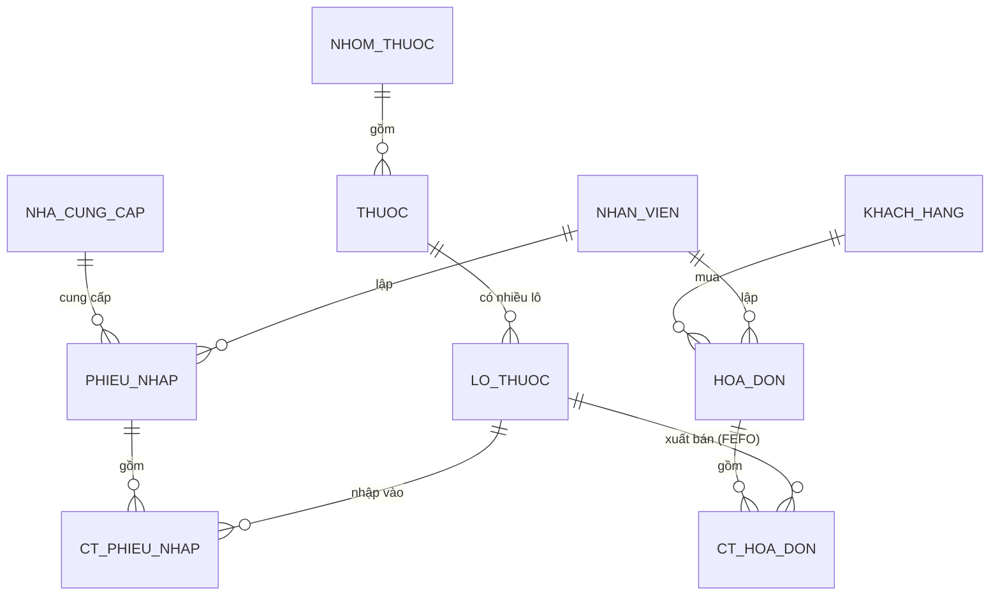

# Sơ đồ thiết kế — QL_NhaThuoc (Quản lý nhà thuốc)

Vẽ theo mẫu bảng đen buổi 25/11: **CSDL → các Table → các cột (field); mỗi dòng dữ liệu là 1 Record.**

## 1. Sơ đồ tổng quát (CSDL → Table → Field)

## 2. Quan hệ giữa các Table

## 3. Bảng chi tiết (Table / Field)

| Table | Khóa chính | Field chính | Khóa ngoại |
|---|---|---|---|
| Nhóm thuốc | Mã nhóm | Tên nhóm, Mô tả | — |
| Thuốc | Mã thuốc | Tên, Hoạt chất, Đơn vị, Giá bán, Nhà sản xuất | Mã nhóm |
| Lô thuốc | Mã lô | Số lô, NSX, Hạn dùng, Số lượng tồn | Mã thuốc |
| Nhà cung cấp | Mã NCC | Tên, SĐT, Địa chỉ, Công nợ | — |
| Khách hàng | Mã KH | Họ tên, SĐT, Địa chỉ | — |
| Nhân viên | Mã NV | Họ tên, Chức vụ, SĐT | — |
| Phiếu nhập | Mã phiếu | Ngày nhập, Tổng tiền | Mã NCC, Mã NV |
| CT phiếu nhập | (Mã phiếu, Mã lô) | Số lượng, Giá nhập | Mã phiếu, Mã lô |
| Hóa đơn bán | Mã HĐ | Ngày bán, Tổng tiền | Mã KH, Mã NV |
| CT hóa đơn | (Mã HĐ, Mã lô) | Số lượng, Đơn giá | Mã HĐ, Mã lô |

## 4. Yêu cầu SQL (theo cột giữa bảng đen)

1. Thêm / sửa / xóa: thuốc, lô, khách hàng, nhà cung cấp…
2. Tìm kiếm: theo tên thuốc, theo ngày (hết hạn / bán).
3. Sắp xếp: theo tên, theo ngày.
4. Báo cáo: tồn kho, thuốc sắp hết hạn, doanh thu theo ngày.

> Đây là bản sơ đồ mức khái niệm cho môn học. Sơ đồ đầy đủ của PHARMACY OS (đa chi nhánh, đa tổ chức) sẽ làm ở Phase 1–2.
